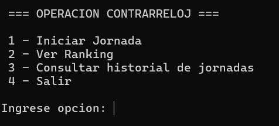
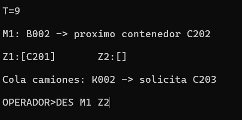
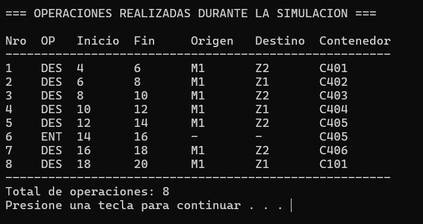

# Puerto de Contenedores: Operación Contrarreloj 🚢⏱️

**Trabajo Práctico – Algoritmos y Estructura de Datos (UNLaM)**

Simulación interactiva por consola desarrollada en **C** en la que asumís el rol de Operador del Puerto. La meta es coordinar la descarga de buques, apilar los contenedores en las zonas de almacenamiento disponibles, moverlos si están tapados y despacharlos en los camiones correspondientes antes de que termine el turno.

> **Aclaración clave:** El reloj del sistema es lógico. No corre mientras estás pensando o escribiendo el comando; solo avanza cuando ejecutás acciones que suman tiempo (o si se fuerza el avance automático).

---

## 👥 Equipo (PILA UNITED)

* **Comisión:** 03-3600
* **Integrantes:**
* De Rogatis, Ramiro Javier | GitHub: `@ramirojavierderogatis090`
* Gatti, Leandro Ezequiel | GitHub: `@lean-gatti`
* Ruiz, Alex  | GitHub: `@alexur15`
* Portilla Martínez, Jeremias | GitHub: `@jerePorti`

---

## 🎮 Comandos en Simulación

Las órdenes se ingresan por consola a traves de `OPERADOR>` (no distingue entre mayúsculas y minúsculas). Si un comando falla por mala sintaxis o por no cumplir las precondiciones, la acción se rechaza sin consumir tiempo.

| Comando | Sintaxis | ¿Qué hace? | Tiempo consumido |
| --- | --- | --- | --- |
| **Descargar** | `DES <muelle> <zona>` | Baja el siguiente contenedor del buque atracado y lo pone en la pila indicada. | `tiempo_descarga_contenedor` |
| **Reubicar** | `REU <zona_origen> <zona_destino>` | Mueve el contenedor del tope de una zona hacia otra pila con lugar. | `tiempo_reubicacion_contenedor` |
| **Entregar** | `ENT` | Despacha la carga al primer camión de la cola (debe estar en el tope de una zona). | `tiempo_carga_camion` |
| **Ver estado** | `VER` | Revisa los próximos 3 camiones en espera y qué contenedor necesitan. | 0 min |
| **Esperar** | `ESP` | Pasa el tiempo a mano. | 1 min |

---

## 🛠️ Reglas del Juego

* **Un solo movimiento a la vez:** El puerto cuenta con una sola grúa/recurso operativo.
* **Llegada de Buques y Camiones:** Ambas colas se manejan de manera FIFO. Los barcos sin muelle quedan en espera y se van asignando automáticamente al primer muelle libre disponible.
* **Reloj Automático:** Si no hay acciones realizables de inmediato, el tiempo salta automáticamente hasta el próximo evento o arribo.
* **Condiciones de Cierre:** El turno termina si se acaba el tiempo, si completás todo el trabajo pendiente o si entrás en un bloqueo operativo (zonas llenas sin poder despachar a ningún camión).
* **Sistema de Puntos:**
* `+10` por cada contenedor despachado.
* `+5` por buque totalmente descargado.
* `-2` por cada camión que se quede esperando al cerrar la jornada.

Al terminar cada partida se despliega el resumen con el puntaje final y el historial paso a paso de lo que hiciste durante el turno.

---

## 📁 Archivos y Configuración

* **`config.txt`:** Define los parámetros globales (tiempos de cada acción, capacidad de las zonas, duraciones, etc.).
* **`puerto.txt`:** Se genera automáticamente al iniciar cada turno con los arribos de buques y camiones aleatorios basados en la configuración.
* **Persistencia Binaria (`operadores.dat`, `indice.dat`, `jornadas.dat`):**
* Los operadores se buscan a través de un **Árbol Binario de Búsqueda (ABB)** que se reconstruye balanceado en memoria desde `indice.dat`.
* Las jornadas jugadas y los puntajes acumulados quedan guardados para armar el ranking global de la cátedra.

---

## 🏗️ TDAs Implementados

Todos los TDAs fueron desarrollados de manera genérica usando punteros `void*`:

* **Pila (`pila.c/.h`):** Para las zonas de almacenamiento y el manifiesto de carga de los barcos.
* **Cola (`cola.c/.h`):** Para los buques en espera, la fila de camiones y el registro del historial.
* **Lista Enlazada (`lista.c/.h`):** Para listar las zonas disponibles y ordenar el cronograma de arribos.
* **Árbol Binario de Búsqueda (`arbol.c/.h`):** Para el índice en memoria de operadores y la generación del ranking.

---

## 🔗 Repositorio

* GitHub: https://github.com/RamiroJavierDeRogatis090/Puerto-de-Contenedores-Operacion-Contrarreloj

---

## 📷 Capturas del Juego

### Menú Principal

### En plena simulación

### Historial de Operaciones

